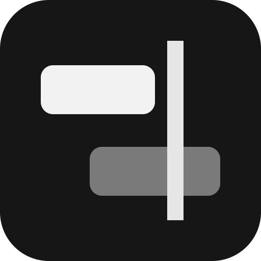
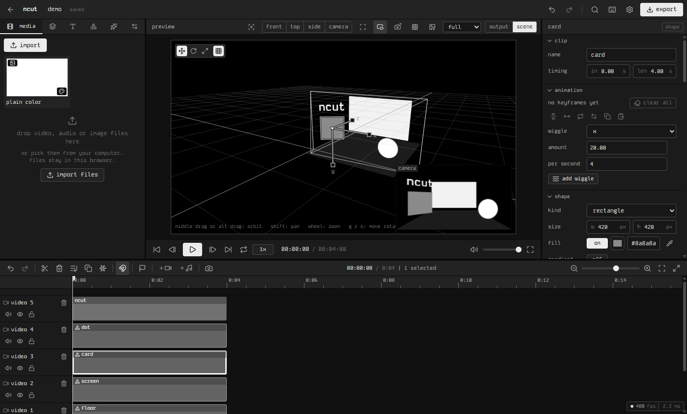

<div align="center">



<h1>ncut</h1>

<p>a flat, monochrome video editor.<br>runs in your browser or as a windows app. nothing gets uploaded.</p>

[](LICENSE)


[features](#features) · [quick start](#quick-start) · [desktop app](#desktop-app) · [shortcuts](#shortcuts) · [development](#development)



</div>

## features

- **timeline** with video, image, text, shape and audio tracks, drop clips inbetween others, drop a clip on the border between two tracks and a new track opens there
- **real time preview**, move / scale / rotate right on the picture
- **keyframes** on nearly every number, each one with its own keys
- **bpm**: ncut finds the tempo of a song (or type it, or tap it), then keyframes loop and snap on the beat, and effects can pulse and lock their rhythm to it
- **3d**: clips become planes or solids in one unlit scene, with cameras and a scene view driven like blender (or like unity, one switch in the settings)
- **94 effects, 87 transitions**, motion blur, masks, green screen
- **text** with 29 fonts plus your own, letter animations, captions
- **a plain color card** in every project, ready to drop in
- **export** to mp4, webm, gif or audio, up to 240 fps, no watermark
- **local only**: projects and media stay on your machine

the full list is in [docs/FEATURES.md](docs/FEATURES.md).

## quick start

you need [node](https://nodejs.org) 22 or newer.

```bash
git clone https://github.com/sagecsharp/ncut.git
```

```bash
cd ncut
```

```bash
npm install
```

```bash
npm run dev
```

then open http://localhost:5173 in a chromium based browser (chrome, edge, brave). export needs webcodecs.

## desktop app

windows only for now.

```bash
npm run exe
```

this builds into `release/`:

- `ncut-<version>-portable.exe` one file, just run it (takes about 2 s to open)
- `ncut-<version>-setup.exe` installer with a start menu entry
- `win-unpacked/ncut.exe` the plain folder, opens the fastest

good to know:

- pin it to the taskbar: start it, right click its taskbar button, pin to taskbar
- a double click on a `.ncut` file opens it
- exports run at full speed when the window is minimized
- projects live in `%APPDATA%\ncut`, separate from the browser version. move one over with its `.ncut` file
- the exe is not code signed, windows smartscreen may ask before the first start

## shortcuts

press `?` in the editor for the full list. the main ones:

- `space` play / pause, `j` `k` `l` shuttle
- `s` split, `delete` delete, `shift+delete` ripple delete
- `[` / `]` cut off the left / right side of the clip at the playhead
- `ctrl+z` / `ctrl+shift+z` undo / redo
- `ctrl+c` `ctrl+x` `ctrl+v` `ctrl+d` copy, cut, paste, duplicate
- `ctrl+g` / `ctrl+shift+g` group / ungroup
- `left` / `right` step one frame
- `m` add a marker
- `ctrl+wheel` zoom the timeline
- `ctrl+k` search every action
- `ctrl+e` export

3d:

- `3` turn 3d on for a clip, `c` add a camera, `v` scene view
- scene view, like blender (pointer over the view): middle drag orbits, `g` `r` `s` move / rotate / scale, `x` `y` `z` pick the axis, type a number, click keeps, right click cancels, `shift+d` copies, numpad picks the view, `f` frames the selection
- scene view, like unity (settings > unity 3d controls): left drag orbits, `w` `e` `r` pick the tool

## development

- `npm run dev` dev server
- `npm run build` typecheck + production build into `dist/`
- `npm run test` unit tests
- `npm run typecheck` typescript only
- `npm run app` build and open the desktop window without packaging
- `npm run app:dev` desktop window on the running dev server
- `npm run exe` build the windows exe files
- `npm run icon` redraw the app icon
- `npm run qos` build the helper for full speed background exports (part of `npm run exe`)

built with vite, react, typescript, zustand, [mediabunny](https://mediabunny.dev) for encoding and decoding, lucide icons and plain css. the desktop app is an [electron](https://www.electronjs.org) window around the same build.

how the code is laid out: [docs/ARCHITECTURE.md](docs/ARCHITECTURE.md).

## contributing

issues and pull requests are welcome. before you open a pull request, run:

```bash
npm run typecheck
```

```bash
npm run test
```

## license

[mit](LICENSE). the bundled fonts come from fontsource and keep their own licenses (mostly sil open font license).
